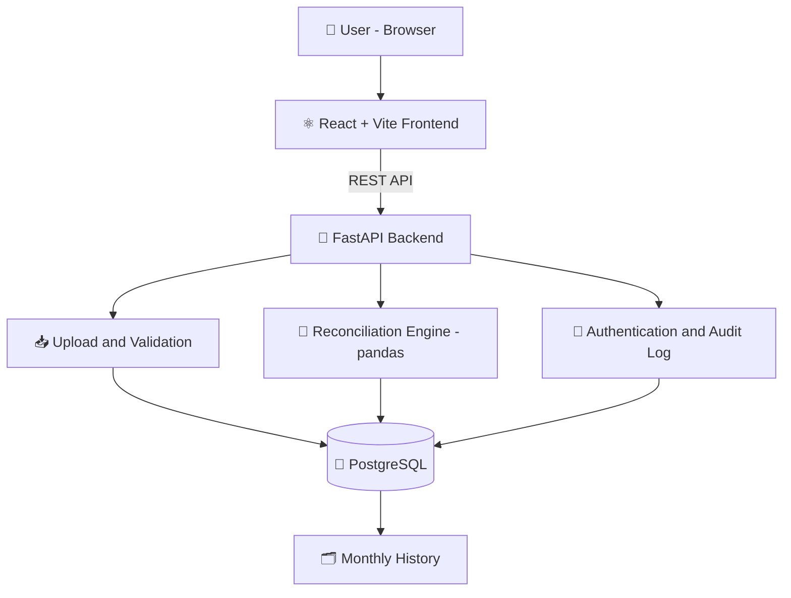
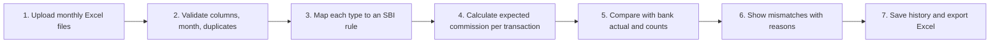
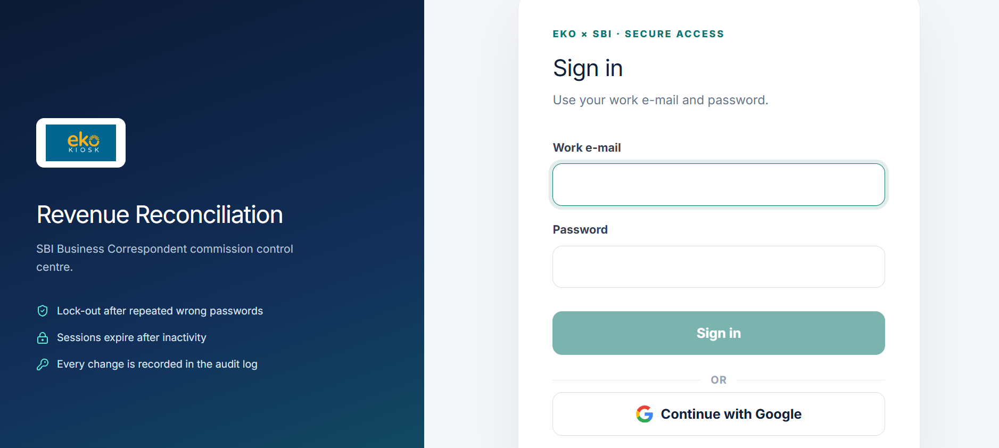
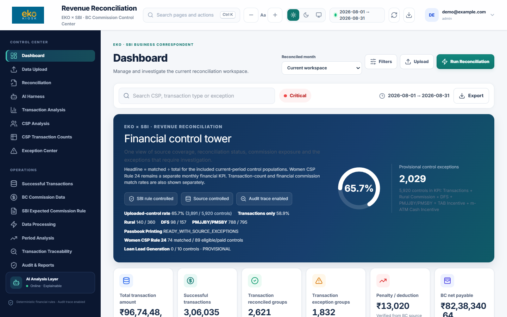
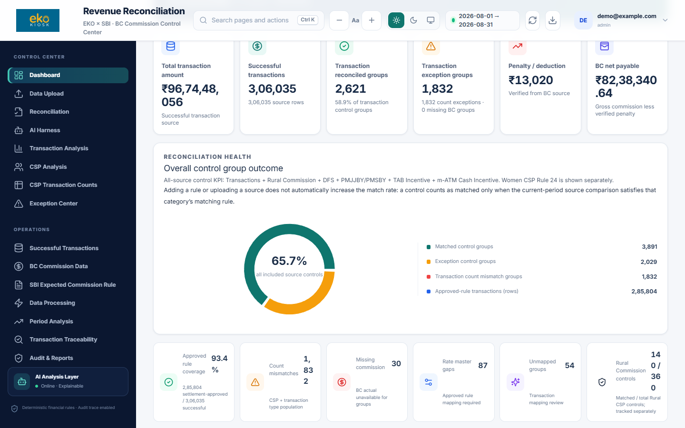
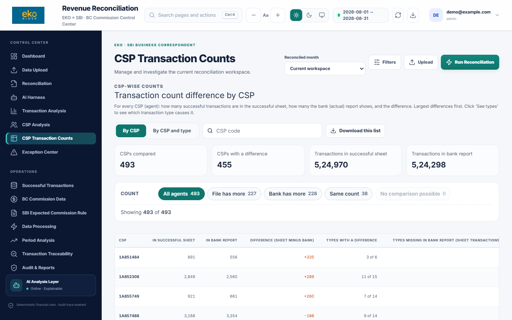
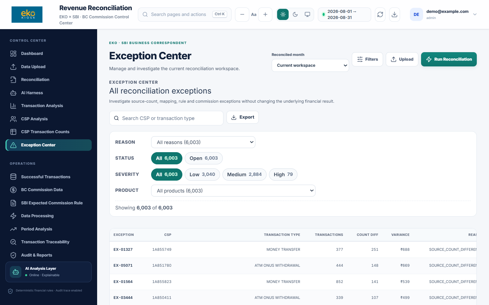
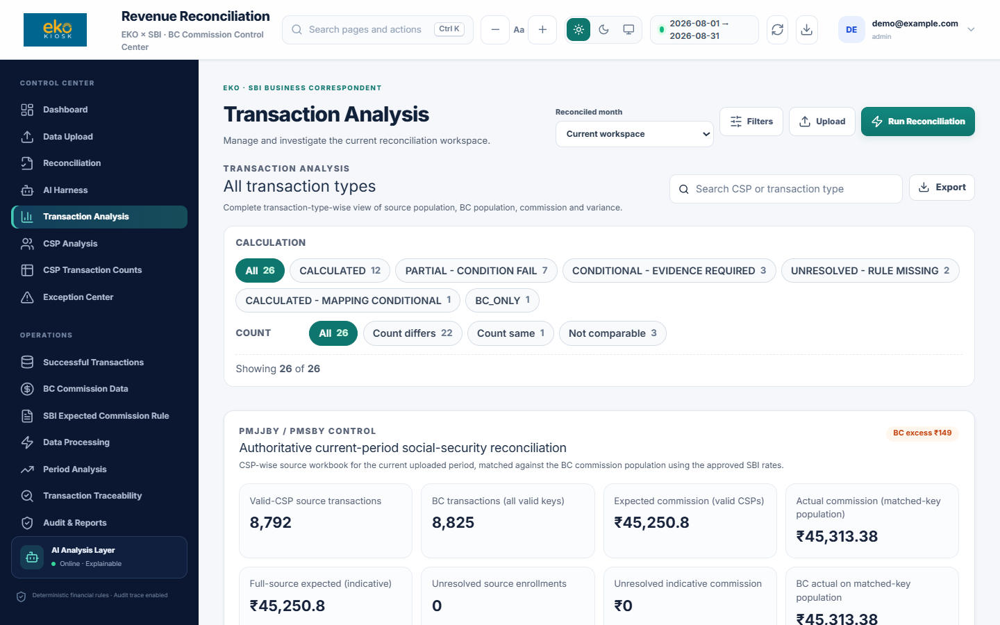

<div align="center">

# 💰 Revenue Reconciliation

### EKO × SBI Business Correspondent Commission Checker

**Find every rupee of commission difference in about 15 seconds, not days.**


-orange)

[Overview](#-overview) · [Features](#-features) · [How it works](#-how-it-works) · [Quick start](#-quick-start) · [API](#-api-endpoints) · [Security](#-security) · [Limits](#-limitations)

</div>

---

## 📊 At a Glance

| | |
|---|---|
| 👥 **Agents checked** | about 500 CSPs every month |
| 🧾 **Transaction types** | 25+ (withdrawal, deposit, money transfer, insurance, passbook and more) |
| ⚡ **Typical run time** | about 15 seconds per month |
| ✅ **Automatic checks** | 448 tests |
| 🎯 **Accuracy method** | every month recalculated independently and matched to the paisa |
| 🗂 **History** | every reconciled month saved and re-openable |

---

## 📖 Overview

EKO works with **State Bank of India (SBI)** as a Business Correspondent. Thousands of field agents (**CSPs**) do banking for customers, and the bank pays a commission on each transaction.

Every month this tool answers three questions:

| Question | Answer comes from |
|---|---|
| 💵 How much commission **should** we get? | SBI commission rules (Expected) |
| 🏦 How much did the bank **actually pay**? | Bank commission report (Actual) |
| 🔢 Do the **transaction counts** agree? | Successful sheet vs bank report |

Then it shows **where** and **why** the numbers differ, agent by agent.

---

## ❗ Problem Statement

Checking by hand in Excel is:

- 🐌 **Slow:** about 500 agents × 25+ transaction types every month
- 🧩 **Complicated:** slabs, caps, rural and urban rates, special schemes
- 🙈 **Risky:** a small rate or count mistake can hide a large amount
- 📝 **Untraceable:** no record of who checked what, and when

---

## 💡 Solution

```
 Upload Excel files  →  Validate  →  Map to SBI rules  →  Calculate expected commission
          →  Compare with bank report  →  List every mismatch with a reason  →  Save & export
```

> 🔒 **Money is calculated by fixed rules, not by AI.** The same files always give the same result.

---

## ✨ Features

<table>
<tr>
<td width="50%" valign="top">

### 🧮 Reconciliation
- Expected vs actual commission, per agent and per type
- Transaction count comparison (sheet vs bank)
- Rural and urban rate handling
- Supplemental products: PMJJBY / PMSBY, Passbook, Women CSP, DFS, mATM, TAB, Loan leads
- Unconfirmed rules shown as **Evidence required** or **Rate missing**, never guessed

</td>
<td width="50%" valign="top">

### 📈 Dashboard & Analysis
- Overall match percentage and totals
- **CSP Transaction Counts:** difference per agent
- Exception Center with a reason for each mismatch
- Period Analysis (day-wise, month-wise)
- Dark mode

</td>
</tr>
<tr>
<td valign="top">

### 🔎 Easy Filters
- Filters on every table with a **count on each option**
- Product, result, count difference, search
- Active filters shown as chips, one-click "Clear all filters"
- Works for the current month and any saved month

</td>
<td valign="top">

### 🗃 Records & Audit
- Every reconciled month saved in history
- Excel export
- Audit log of every run and change
- Source Data pages: uploaded rows exactly as received

</td>
</tr>
</table>

---

## 🏗 System Architecture



---

## 🔄 How It Works



**Key rules**

- 🧾 Amounts are rounded **per transaction**, half-up to the paisa.
- 🏘 Rural and urban agents use different caps, as in the SBI structure.
- ♻️ Results are remembered for the same files, so a repeat run is quick.
- 🛑 Where SBI has not confirmed a rule, the row is flagged for evidence.

---

## 📁 Project Structure

```
📦 Revenue-Reconciliation
 ┣ 📂 backend      → API, reconciliation engine, SBI rules, database code, tests
 ┣ 📂 frontend     → Web interface (React + Vite)
 ┣ 📂 docs         → Guides, rule notes and release notes
 ┣ 📂 tests        → Project-level checks
 ┣ 📂 tools        → Packaging and benchmark scripts
 ┣ 📂 deploy       → Settings for hosted (server) setup
 ┣ 📜 start.bat    → Starts everything on Windows
 ┗ 📜 README.md
```

---

## 🖼 Screenshots

> Screenshots use sample (anonymised) data: agent codes are changed and money amounts are scaled.

### 🔐 Login Page

<p align="center">
  
</p>

### 📊 Dashboard

<p align="center">
  
</p>

<p align="center">
  
</p>

### 🔢 CSP Transaction Counts

Difference between the successful sheet and the bank report for every CSP, with count filters.

<p align="center">
  
</p>

### ⚠️ Exception Center

All mismatches with easy filters (reason, status, severity, product).

<p align="center">
  
</p>

### 📈 Transaction Analysis

<p align="center">
  
</p>

---

## ⚙ Technologies Used

| Layer | Technology |
|---|---|
| 🐍 Backend | Python, FastAPI, Uvicorn, pandas, SQLAlchemy |
| ⚛️ Frontend | React, Vite |
| 🐘 Database | PostgreSQL (embedded, starts automatically); SQLite in tests |
| 🔐 Sign-in | Email and password (cookie sessions), Google sign-in (OpenID Connect), API keys |
| 🧪 Testing | pytest |

---

## 🚀 Quick Start

**Requirements:** Windows 11 · Python 3.10+ · Node.js 18+

```bash
git clone https://github.com/Shivam-1980/Revenue-Reconciliation-.git
cd Revenue-Reconciliation-
start.bat
```

Then open 👉 **http://127.0.0.1:5173**

| Step | What to do |
|---|---|
| 1️⃣ | Sign in |
| 2️⃣ | Open **Data Upload** and upload the monthly files |
| 3️⃣ | Run the reconciliation |
| 4️⃣ | Review **Dashboard**, **CSP Transaction Counts**, **Exception Center** |
| 5️⃣ | Export to Excel |

📚 API documentation: http://127.0.0.1:8000/docs

> ℹ️ `start.bat` creates the Python environment and installs everything on first start.

---

## 🔧 Configuration

- Copy `backend/.env.example` to `backend/.env` and fill in your own values.
- ⚠️ Never commit `.env`, keys or certificates (they are in `.gitignore`).

| Optional setup | How |
|---|---|
| 🔑 Google sign-in | run `setup_google_login.bat` (guide: `docs/GOOGLE_SIGN_IN.md`) |
| 🌐 Access from other PCs | run `allow_network_access.bat` as administrator (guide: `docs/AGENT_API.md`) |
| 💾 Backup and disk checks | run `owner_security_steps.bat` |

---

## 📡 API Endpoints

<details>
<summary><b>Click to expand the main endpoints</b> (all need sign-in)</summary>

**Version**

```
GET  /api/version
```

**Upload monthly files**

```
POST /api/upload/transactions
POST /api/upload/commission
POST /api/upload/rural-csp
POST /api/upload/social-security-counts
POST /api/upload/passbook-printing-counts
POST /api/upload/women-csp-roster
POST /api/upload/dfs-incentive
POST /api/upload/matm-incentive
POST /api/upload/tab-incentive
POST /api/upload/loan-lead-generation
```

**Reconciliation**

```
POST /api/reconciliation/run
GET  /api/reconciliation/status
GET  /api/reconciliation/csp
GET  /api/reconciliation/csp-type
GET  /api/reconciliation/transaction-type
GET  /api/reconciliation/exceptions
GET  /api/reconciliation/export?format=xlsx
GET  /api/reconciliation/history
GET  /api/dashboard/summary
```

**AI Harness**

```
POST /api/ai-harness/investigate
```

Full interactive list at `/docs`.

</details>

---

## 🤖 AI Harness

A helper made of **fixed tools** that tells the reviewer **where to look first**.

| ✅ It does | ❌ It does not |
|---|---|
| Rank problems by score (gap size, missing rule, amount at risk) | Use an AI model |
| Explain the likely cause of each problem | Give opinions |
| | Change any amount |

---

## 🔒 Security

- 🔐 Sign-in required; repeated wrong passwords lock the account for a while
- ⏱ Sessions expire when idle
- 🧾 Every important action is recorded in the audit log
- 🔒 Access from other computers needs HTTPS; plain network access is refused
- 🚫 Secrets and monthly data are never stored in this repository

---

## 🧪 Testing

```bash
python -m pytest -q
```

**448 automatic checks** cover rules, calculations, uploads, security and the AI Harness.

---

## ⚠ Limitations

- 🕓 Some SBI rules still wait for bank confirmation (for example the exact Money Transfer mapping and BBPS rates). They show as **Evidence required** until confirmed.
- 🔢 The bank report may count fewer transactions than the successful sheet (very small transactions, repeated attempts). The app shows the difference; the reason has to come from the bank.
- 🏢 Built for one organisation on one PC or server, not a multi-company product.
- 👀 Human review is recommended before any claim is sent to the bank.

---

## 🔮 Future Improvements

- [ ] Month-to-month comparison charts
- [ ] Scheduled monthly reports by email
- [ ] Bank-confirmed rule updates inside the app
- [ ] Saved filter views
- [ ] Hosted (server) deployment for many users

---

<div align="center">

### 👨‍💻 Author

**Shivam Solanki**

*Making commission checking fast, accurate and auditable.*

⭐ If you find this project useful, don't forget to star the repository!

</div>
